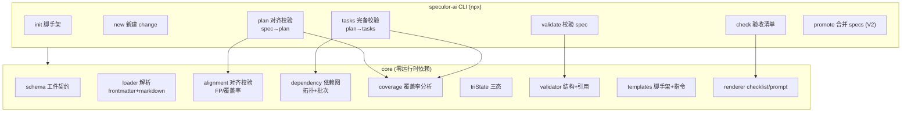

# speculor-ai — 技术提案（重构版 v2）

> **一个真正的 Spec-Driven Development（SDD）工具**：agent 无关、零依赖、TypeScript 原生。
> 它的核心不是"管理 spec 文件"，而是——**机器如何校验 AI 的产出忠实于人的意图**。
>
> 人写 spec → AI 生成 plan/tasks/代码 → **speculor-ai 逐层校验 AI 是否照着 spec 干了活** → 人确认 → 合并。

---

## 0. 版本说明与重构动机

本版从"轻量 spec 管理工具"重构为"真正的 SDD 工具"。重构前对方案做了自检，发现三个必须对齐的矛盾，本版逐一回应：

| 原矛盾                                                    | 本版的对齐                                                                                                                                                                               |
| --------------------------------------------------------- | ---------------------------------------------------------------------------------------------------------------------------------------------------------------------------------------- |
| **校验被高估**：结构校验（id/字段）对 AI 生成质量影响很小 | 把"校验"从**结构层**上移到**对齐层**——校验的不是文件格式，而是 **plan/tasks 是否忠实覆盖 spec**。这才是 AI 生成质量的真问题                                                              |
| **agent 无关摊薄价值**：不做生成 = 价值变薄               | 明确分工：**AI 是生成者，speculor-ai 是校验者 + 编排者**。agent 无关不是说"只是标准文件"，而是"speculor-ai 永不替 AI 干活，只校验 AI 是否遵守人的意图"——这是稳定的职责边界，不是功能缺失 |
| **产物太薄**：init/new/validate/check 只是文件 CRUD       | 引入**对齐校验**（spec→plan→tasks 覆盖率 + 依赖拓扑 + 批次划分）——有算法深度的核心，也是 showcase 的含金量锚点                                                                           |

---

## 1. 业界调研结论

### 1.1 SDD 核心理念（共识）

- **Intent first, code second**：先「做什么、为什么」，后「怎么做」。
- **Spec 是唯一事实来源**：代码从 spec 生成；spec 变，实现跟变。
- **门控流程**：分阶段 + 人工确认，避免 AI 一把梭。
- **结构化沟通**：用标准工件替代 ad-hoc prompt。

### 1.2 代表实现与差异

| 工具                              | 生态                 | 核心机制                                               | 强项                   | 局限                            |
| --------------------------------- | -------------------- | ------------------------------------------------------ | ---------------------- | ------------------------------- |
| **GitHub Spec Kit**               | Python/uv，28K+ star | `specify` CLI + `/speckit.*` slash 命令，5 阶段门控    | 企业级治理、门控成熟   | 需装 Python/uv；绑定 slash 机制 |
| **OpenSpec**                      | Rust/Markdown        | `specs/` + `changes/` 两目录，skill+command 注入 agent | 轻量、状态与 diff 分离 | 校验与验收闭环弱；绑定 agent    |
| **SpecDriver / Kiro / SpecKitty** | 多样                 | spec↔代码同步、worktree 隔离、governance loop          | 各占细分               | 生态分散                        |

### 1.3 机会点（本版差异化定位的依据）

1. **主流工具绑 agent、绑语言生态**（Python/Rust、slash command）——前端要额外装东西，且换 agent 就失效。
2. **spec 缺乏强校验**：多为"约定文件夹"，没有机器可校验的强约束。
3. **验收无闭环**：acceptance criteria 大多是文本，没有转成可执行清单。
4. **最重要：没有人校验"AI 的 plan/tasks 是否忠实于 spec"**。所有工具都假设"AI 会照着 spec 干活"，但**没有任何工具机器校验这一点**——这是真正的空白。

---

## 2. 核心命题与定位

### 2.1 核心命题

> **AI 会"跑偏"：它会遗漏 spec 里的功能点、会用和 spec 冲突的技术决策、会跳过验收项。**
> speculor-ai 的价值 = **逐层机器校验 AI 的产出（plan/tasks/清单）是否忠实于人的意图（spec）**。

它不是"帮 AI 干活"，而是"**替人监督 AI 有没有照着 spec 干活**"。

### 2.2 定位一句话

> **一个零依赖、`npx` 即用的 TypeScript SDD 工具——人写 spec，AI 生成方案与任务，speculor-ai 逐层校验对齐并门控推进。**

### 2.3 谁生成 / 谁校验（职责边界）

| 角色       | 谁                                                     | 做什么                                              |
| ---------- | ------------------------------------------------------ | --------------------------------------------------- |
| **生成者** | 任意编码 AI（Claude Code / Copilot / Cursor / Codex…） | 读 spec → 产出 plan.md / tasks.md / 代码            |
| **校验者** | speculor-ai                                            | 定义工件契约 + 校验 AI 产出是否覆盖 spec + 门控推进 |
| **仲裁者** | 人                                                     | 每个阶段出口确认（门控）                            |

### 2.4 差异化对比表

| 维度       | speculor-ai                              | Spec Kit           | OpenSpec       |
| ---------- | ---------------------------------------- | ------------------ | -------------- |
| 安装       | `npx speculor-ai`（Node 原生）           | Python `uv`/`pip`  | Rust binary    |
| Agent 依赖 | **无关**（AI 是插拔的生成者）            | 绑定 slash command | 绑定特定 agent |
| 核心差异化 | **spec→plan→tasks 逐层对齐校验**         | 门控治理           | 状态/diff 分离 |
| 校验对象   | AI 的产出是否忠实于 spec（机器可判）     | 无机器校验         | 无机器校验     |
| 验收闭环   | acceptance criteria → 带判定的 checklist | 文本清单           | 文本清单       |
| 事实可追溯 | 逐项三态 ✅/🟡/⚠️                        | 无                 | 无             |

---

## 3. 核心闭环与命令语义

### 3.1 SDD 闭环（speculor-ai 覆盖的部分）

```
spec(需求) ─► plan(技术方案) ─► tasks(任务拆解) ─► implement(实现) ─► verify(验收)
    ▲  speculor-ai 契约+校验      ▲  speculor-ai 对齐校验   ▲ AI 完成    ▲ speculor-ai check
```

- **speculor-ai 管**：spec / plan / tasks 的契约定义 + 逐层对齐校验 + 门控 + 验收清单。
- **AI 管**：读 spec 生成 plan、读 plan 生成 tasks、按 tasks 写代码。
- **speculor-ai 永远不生成 plan/tasks 内容**——它只校验，所以零依赖、不绑 LLM、agent 无关。

### 3.2 命令语义（MVP 六个命令）

| 命令         | 输入                      | speculor-ai 做什么（核心）                                                                                  | 校验的技术含金量                 |
| ------------ | ------------------------- | ----------------------------------------------------------------------------------------------------------- | -------------------------------- |
| `init`       | —                         | 生成 `.specdev/` 脚手架（constitution、specs/、changes/、模板）                                             | —                                |
| `new <name>` | —                         | 建 change，产出带 frontmatter + 三态示例的 spec.md 模板                                                     | —                                |
| `validate`   | spec.md                   | 校验 spec：结构合法、id 唯一、dependsOn 引用、三态门控                                                      | 结构 + 引用图                    |
| `plan`       | spec + AI 产出的 plan.md  | 输出"生成方案指令"给任意 agent；**校验 plan 是否覆盖 spec 的全部 FP 与 acceptance criteria**、plan 契约合法 | **spec→plan 对齐 + 覆盖率**      |
| `tasks`      | plan + AI 产出的 tasks.md | 输出"拆任务指令"；**校验任务是否完备覆盖 plan 的模块/FP**、任务依赖拓扑排序、给出批次划分建议               | **plan→tasks 完备性 + 依赖拓扑** |
| `check`      | spec                      | 从 acceptance criteria 生成带优先级 + 验证判定的 checklist.md                                               | 验收清单生成                     |

> `promote`（change → specs 合并）放 V2，作为 spec 增量 diff 能力。

### 3.3 对齐校验的判定逻辑（核心算法）

**plan 对齐校验（spec → plan）**：

1. 从 spec 提取全部 FP（三态 items）+ acceptanceCriteria。
2. 解析 AI 产出的 plan.md：提取其覆盖的功能点 / 模块 / 技术决策（按 spec 定义的约定，如显式引用 spec 的 FP id）。
3. **覆盖率计算**：被 plan 覆盖的 FP 数 / 总数；低于阈值（如 100% 覆盖 required FP）→ error。
4. 校验 spec 中 `⚠️ pending` 项在 plan 里没有被当作已确认处理（三态在 plan 中保持诚实）。
5. 校验 plan 的**技术决策不与 constitution.md 的项目原则冲突**（可配置规则）。

**tasks 对齐校验（plan → tasks）**：

1. 解析 tasks.md：每个任务绑定到 plan 的模块 / FP。
2. **完备性**：plan 的所有模块都有对应任务；每个 required FP 至少一个任务。
3. **依赖拓扑**：任务间依赖关系成 DAG；若有环 → error；给出拓扑序。
4. **批次划分**：按"同批次内无依赖任务并行（≤3）"给出建议批次（借鉴 woven 的批次规则）。

---

## 4. 架构分层



### 模块职责

| 模块              | 职责                                                           |
| ----------------- | -------------------------------------------------------------- |
| `cli`             | 子命令分发、参数解析、门控确认交互                             |
| `core/schema`     | spec / plan / tasks 的工件契约（frontmatter 字段、枚举、依赖） |
| `core/loader`     | 读取 `.specdev/`，解析 frontmatter + 正文 + 三态               |
| `core/validator`  | 结构合法、id 唯一、dependsOn 引用、三态门控                    |
| `core/alignment`  | **spec→plan→tasks 逐层对齐**（FP/验收项覆盖率）——核心差异      |
| `core/dependency` | 任务依赖图构建、环检测、拓扑排序、批次划分                     |
| `core/coverage`   | 覆盖率计算与阈值判定                                           |
| `core/triState`   | 三态标记解析（✅/🟡/⚠️）                                       |
| `core/templates`  | 脚手架、spec/plan/tasks 模板、给 agent 的生成指令              |
| `core/renderer`   | 渲染 checklist、对齐报告、门控提示                             |

---

## 5. 工件契约

### 5.1 目录约定

```
.specdev/
├── constitution.md          # 项目原则（可被 plan 对齐校验引用）
├── specs/                   # 当前真相 = 唯一事实来源
│   └── <capability>/spec.md
└── changes/<name>/
    ├── spec.md              # 需求（what/why + 三态 FP + acceptanceCriteria）
    ├── plan.md              # 技术方案（AI 产出，speculor-ai 校验对齐）
    ├── tasks.md             # 任务清单（AI 产出，speculor-ai 校验完备 + 依赖）
    └── checklist.md         # 验收清单（由 speculor-ai check 生成）
```

### 5.2 spec.md 契约（frontmatter + 三态）

```markdown
---
id: auth-login
capability: auth
status: proposed # proposed|planned|in-progress|done|archived
priority: P0 # P0|P1|P2
dependsOn: []
acceptanceCriteria:
  - '未登录访问受保护路由 → 重定向到登录页'
  - '登录成功后写入会话并 30 分钟内有效'
---

# 登录功能

## 功能点（三态：✅已确认 / 🟡默认方案 / ⚠️待确认）

- ✅ 未登录访问受保护路由 → 重定向到登录页
- 🟡 会话有效期默认 30 分钟（默认方案，未显式确认）
- ⚠️ 是否需要"记住我"（待确认，阻塞 validate）

## 范围

（包含 / 不包含）
```

### 5.3 plan.md / tasks.md 契约（speculor-ai 校验的对象）

- **plan.md**：frontmatter 声明 `spec: <id>`（对齐哪个 spec）、`modules: [...]`、`decisions: [...]`；正文按模块给出方案。**speculor-ai 校验其覆盖 spec 的 FP/验收项**。
- **tasks.md**：每个任务 `- [ ] (module) 描述` 绑定 plan 模块，依赖用 `dependsOn: task-id` 声明。**speculor-ai 校验完备性 + 拓扑 + 批次**。

---

## 6. 门控协议

每个阶段出口统一三选一（CLI 确认实现，不依赖任何 AI 的私有机制）：

| 选项       | 含义       | speculor-ai 行为                 |
| ---------- | ---------- | -------------------------------- |
| 继续       | 认可产出   | 进入下一阶段                     |
| 暂停       | 先停       | 记录进度 + 恢复点，停止          |
| other/反馈 | 产出有问题 | 反馈写入 change 目录，重跑该阶段 |

- `validate` 有 `⚠️ pending` 项 → 阻塞，除非确认或 `--allow-pending`。
- `plan`/`tasks` 对齐校验不达标 → 阻塞，附对齐报告（哪个 FP 没覆盖、哪个环）。
- 门控默认开启，`--force` 显式跳过（面向熟练用户）。

---

## 7. 技术选型

| 项           | 选择                                        | 理由                                  |
| ------------ | ------------------------------------------- | ------------------------------------- |
| 语言         | TypeScript（strict）                        | 类型安全、贴合前端                    |
| 运行时       | Node 18+，零运行时依赖                      | `npx` 即用，可 tree-shake             |
| 参数解析     | 自写极简                                    | 保持零依赖                            |
| **校验引擎** | **自写**：alignment / dependency / coverage | 这是差异化核心，不是复用 ajv 能替代的 |
| YAML 解析    | 自写 frontmatter 子集                       | 避免引入依赖                          |
| 测试         | vitest（+ 覆盖率门槛）                      | 与 pico-http 一致                     |
| 分发         | npm 发布 `speculor-ai` + `npx`              | 前端零摩擦                            |
| 工程链       | 复用 pico-http：lint/prettier/coverage/CI   | 成熟经验                              |

> **取舍**：`alignment`/`dependency`/`coverage` 是项目的算法核心，也是 showcase 的技术含金量。它们**必须是自写的**——不是"能不能用现成库"的问题，而是"这正是这个项目存在的理由"。

---

## 8. 里程碑

### MVP（真正的 SDD 闭环）

1. `init` / `new`：脚手架 + change 模板。
2. `validate`：spec 结构 + 引用 + 三态门控。
3. `plan`：生成方案指令 + plan 契约 + **spec→plan 对齐/覆盖率校验**。
4. `tasks`：生成任务指令 + **完备性校验 + 依赖拓扑 + 批次划分**。
5. `check`：acceptance criteria → 带判定 checklist。
6. 配套：README / LICENSE / CI / 测试 / examples。

### V2

7. `promote`：change → specs 合并，spec 增量 diff。
8. agent 适配：检测 agent CLI 生成可执行命令（可选，不破坏 agent 无关）。

### V3

9. VS Code 插件（spec 高亮 / 校验 / 对齐报告可视化）。
10. CI 集成：spec 变更自动触发 validate + 对齐检查。

---

## 8.5 技术演进：对齐校验的可信度路线

**核心问题**：当前对齐校验依赖"covers 显式声明 + 归一化文本匹配"，是**字面匹配而非语义匹配**，存在两类失真：

- **误报漏（FN）**：AI 措辞不同但意思相同（"校验登录态" vs "验证用户是否登录"）→ 明明覆盖却判漏；
- **误放行（FP）**：措辞"沾边"却不满足验收 → 可能被骗过。

本质：监督器靠字符串判断"忠实"，面对的是自然语言，可信度有天花板。演进目标是**让门禁从"启发式判定"变成"可复核、可度量、不被糊弄"**。

### 8.5.1 证据链（Evidence Chain）— 最高杠杆，先做

> **状态：已评审并实施（v0.2）**，详见 `docs/evidence-chain.md` 与 `docs/evidence-chain-review.md`。

从"机器判定"升级为"**机器判定 + 可复核证据**"：

- 每项覆盖必须产出它在 plan 中的**证据位置**（段落定位 / 行号 / 一句摘录）；
- 校验报告同时输出 `✅ 已覆盖 ← 证据：plan.md L24 "路由守卫用 middleware…"`；
- 价值：a) 人工一眼复核，FN 可追溯；b) **倒逼 AI 生成 plan 时主动自我声明证据**，写得更忠实；c) 门禁从"黑箱判定"变"可审计判定"。

### 8.5.2 置信度分层（Confidence）

- 每项给匹配置信度 0–1；低置信项标记 `⚠ 需人工确认`，而非二元判过/判挂；
- 门禁分三层：**结构（确定性）→ 对齐（启发式）→ 语义（可选）**，报告标注每层可信度。

### 8.5.3 语义对齐（可选深度模式 `--deep`）

- 引入 embedding / LLM 做语义相似度，按阈值判覆盖；
- **硬约束**：作为一等公民的可选模式，**core 保持零依赖**——默认走本地启发式，`--deep` 作为独立可插拔入口对接外部模型，不破坏"零依赖"卖点。

### 8.5.4 对抗鲁棒性（Adversarial Tests）

- 构造"看似覆盖实则偏离"的 plan（只字面复述 FP 却不给方案）作为 **adversarial 测试集**，验证校验器能否识别；
- 把"监督器不易被糊弄"变成**可测的承诺**，与证据链配套做。

### 8.5.5 流程易用性

- **增量校验**：`--change <name>` 只校验单个 change，大项目反馈秒级；
- **watch 模式**：监听 `.specdev/` 文件变化自动重跑校验；
- **验收闭环**：checklist 勾选回写，反映到 spec 状态（当前 checklist 是"死清单"）；
- **失败可操作化**：plan 校验失败不只报"未覆盖"，而是给 AI **修正引导**（漏了哪条、建议补到 plan 哪一节）；
- **上下文打包**：把当前 change 的 spec+plan+tasks 合成一份 prompt，降低 AI 多文件读取成本。

### 优先级

| 优先级 | 方向                    | 性价比                                               |
| ------ | ----------------------- | ---------------------------------------------------- |
| 🥇     | 证据链                  | 不动算法，把现有匹配结果变可审计输出，立即提升可信度 |
| 🥈     | 增量校验 + 失败可操作化 | 高，直接改善日常手感                                 |
| 🥉     | 置信度分层              | 中，需重构判定输出                                   |
| 远期   | 语义对齐（--deep）      | 高价值但引入外部依赖，需权衡卖点                     |
| 配套   | 对抗测试                | 与证据链一起做，把可信度变成可测承诺                 |

---

## 9. 风险与边界

- **对齐校验的前提是"AI 会产出结构化 plan/tasks"**：为此 speculor-ai 提供明确的 plan/tasks 契约 + 生成指令，把"任意 AI 产出"规范到可校验的形态。这是契约设计的工作，不是假设。
- **对齐是近似不是完美**：FP 与 plan 的匹配允许人工仲裁（门控），speculor-ai 给出机器判定 + 报告，最终由人确认——避免"机器过度自信"。
- **不与 Spec Kit 正面竞争**：Spec Kit 强在门控治理；speculor-ai 错位在"**机器校验 AI 产出忠实度**"，这是空白。
- **格式一旦发布难回退**：spec/plan/tasks 契约 + 三态是外部契约，V1 尽量稳定。
- **三态要克制**：只用于需区分事实/假设的 FP 和验收项，不要求全文逐句打标。

---

## 10. 下一步

1. 本提案已对齐自检三矛盾（定位升级为"真正的 SDD 工具"）。
2. 按此实现 MVP 六个命令（`init/new/validate/plan/tasks/check`），核心为 `alignment`/`dependency`/`coverage` 三个算法模块。
3. 全套工程链 + 测试 + 覆盖率 + CI + 治理文档。
4. 发布方式（npm + npx）待定。
5. **具体实现等用户指令再开始。**
