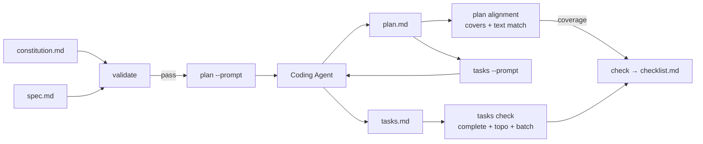

# speculor-ai

> A zero-dependency, `npx`-ready **Spec-Driven Development (SDD)** tool.
> You write the spec, the AI produces the plan and tasks, and **speculor-ai
> verifies — layer by layer — that the AI output stays faithful to your intent**, gating progress.

[](https://github.com/NathanBoy/speculor-ai/actions/workflows/ci.yml)
[](https://opensource.org/licenses/MIT)
[](https://www.npmjs.com/package/speculor-ai)

<p align="center">
  
</p>

---

## What it is

There are plenty of SDD tools (Spec Kit, OpenSpec), but most share the same gap:
**they assume "the AI will follow the spec" yet provide no machine check for it.**
The AI drops feature points, adopts conflicting technical decisions, skips
acceptance items — that's exactly the problem speculor-ai solves.

**The core question: how do we _mechanically_ verify that AI output
(plan / tasks / checklists) stays faithful to human intent (the spec)?**

speculor-ai is **not here to "help the AI do work" — it's here to
"supervise whether the AI is doing the work you asked for".**

| Role         | Who                                                     | What                                                                              |
| ------------ | ------------------------------------------------------- | --------------------------------------------------------------------------------- |
| Generator    | Any coding AI (Cursor / Codex / Claude Code / Copilot…) | Reads spec → produces plan.md / tasks.md / code                                   |
| **Verifier** | **speculor-ai**                                         | Defines the artifact contract + checks AI output covers the spec + gates progress |
| Arbitrator   | You                                                     | Confirms each stage before it moves forward                                       |

## Why agent-agnostic

- **AI tooling churns fast; being locked in is a risk**: wiring your workflow
  to a single vendor (e.g. Claude Code's Plugin/Hook) makes the whole thing
  obsolete when you switch. speculor-ai depends only on "files + validation",
  which never goes stale.
- **Spec files are long-term assets; tools are transient programs**: the spec is
  the project's source of truth (data), the agent is just a program that reads it;
  data exists independently of any program.
- **Lower the barrier**: no need to install a specific agent to use a spec tool —
  just use whatever you already have.

Because it's agent-agnostic, integrating speculor-ai doesn't depend on which
tool you use — it's always the same two steps:
**① make the AI aware of this workflow ② run speculor-ai in the terminal / CI.**

## What it does NOT do

Being clear about what it doesn't do matters as much as what it does:

- **It doesn't generate plans / tasks**: speculor-ai is a **verifier**, not a
  generator. The plan/tasks content is produced by your coding AI; speculor-ai
  only checks whether that output is faithful to the spec.
- **No scaffolding or code generation**: it never touches source code — it only
  reads and writes the spec files under `.specdev/`.
- **Not bound to any agent / IDE**: it uses plain Markdown files that anyone can
  read (see above).
- **Not a repository-management tool**: branching, merging, releasing are Git's
  and CI's job.
- **Not a general static analyzer**: it only does alignment and completeness
  checks along the "spec → plan → tasks" SDD chain.

## Architecture



- `core/`: dependency-free core (schema / loader / validator / plan / tasks / renderer)
- `cli/`: a thin shell over the six subcommands; all logic lives in `core`
- Validation failures are expressed via **exit code**, so they can gate the flow
  in the terminal, CI, or a git hook.

## Install

```bash
npx speculor-ai --help
```

No global install, zero dependencies, Node 18+.

## Quick start

```bash
# 1. Scaffold the spec directory
npx speculor-ai init

# 2. Open a new change
npx speculor-ai new auth-login

# 3. Write the spec (have the AI draft it, you confirm the tri-state), then validate
npx speculor-ai validate

# 4. Have the AI produce a plan; speculor-ai checks alignment
npx speculor-ai plan --prompt     # outputs the generation instruction for the AI
npx speculor-ai plan              # checks the AI-produced plan covers the spec

# 5. Have the AI break it into tasks; speculor-ai checks completeness + deps
npx speculor-ai tasks --prompt
npx speculor-ai tasks

# 6. Generate the acceptance checklist
npx speculor-ai check
```

---

## Workflow: paste a PRD + agent generates + speculor-ai gates

**The recommended way to use it**: paste the PRD right into the IDE, let the
agent generate, and have speculor-ai do QA and gating on the side.

> **Key point**: a PRD cannot be used as a spec "as-is". The PRD is raw input;
> the spec is a **structured artifact** — the agent's job is to turn the PRD
> into a contract-conforming spec (with frontmatter + ✅🟡⚠️), and speculor-ai's
> job is to verify that conversion is sound.

Using Cursor as an example, the full flow:

```
① Cursor:  paste a PRD and ask the agent
   "Using the template at .specdev/changes/auth-login/spec.md,
    expand the PRD into a spec with frontmatter + ✅🟡⚠️ tri-state"
   → agent produces spec.md

② Terminal: npx speculor-ai validate
   → blocks on ⚠️ pending items; you confirm, then re-run until green

③ Cursor:  "Read spec.md and produce a technical plan.md"
   → agent produces plan.md

④ Terminal: npx speculor-ai plan
   → alignment report: low coverage and dropped feature points are laid bare
   → have the agent fix it, re-run until green

⑤ Cursor:  "Break the plan into tasks.md"
   → agent produces tasks.md

⑥ Terminal: npx speculor-ai tasks
   → completeness + acyclic dependencies + batch suggestions

⑦ Cursor:  have the agent implement per the tasks
   Terminal: npx speculor-ai check → generates the acceptance checklist
   → agent self-tests against the checklist, you confirm item by item
```

**Your rhythm**: alternate between a chat in Cursor (generate) and running
speculor-ai in the terminal (verify). Cursor does the "thinking", speculor-ai
does the "cold-eyed checking", and you do the "call".

### Gating: files are the state

speculor-ai keeps no session state — **all state lives in files** (the spec's
tri-state, plan/tasks content, checklist ticks). That makes it auditable,
resumable after interruption, and scriptable by nature.

- **Artifact-driven (default)**: each run outputs a verdict + report; you fix
  the files (or have the agent do it), re-run, and progress.
- **Interactive confirmation (optional)**: `--interactive` offers a terminal
  choice after each run (continue / pause / other).
- **Pure verdict (CI)**: no interaction; on failure it exits `!= 0`, ready to
  drop straight into CI.

---

## Multi-IDE integration guide

Because it's agent-agnostic, **switching tools doesn't change anything in
speculor-ai — you only change "where the rules file lives"**.

### Cursor

```
① Rules file   .cursor/rules/speculor-ai.mdc:
   This project uses the speculor-ai workflow. Before implementing any
   feature, read .specdev/changes/<name>/spec.md and tasks.md; after
   finishing, self-test against checklist.md.
② Built-in terminal   run npx speculor-ai init / validate / plan / tasks / check
③ Panel chat   have the AI work; it reads the rules + the .specdev/ files
```

### Codex (CLI or IDE extension)

```
① Rules file   AGENTS.md (Codex reads it):
   # speculor-ai workflow
   Before changing code, read .specdev/changes/<name>/spec.md …
② Run commands npx speculor-ai plan --prompt
               copy the output into codex: codex "（paste the instruction）"
③ Verify       npx speculor-ai plan → review the alignment report
```

### VS Code + other extensions / JetBrains

```
① Rules file   AGENTS.md (IDE-agnostic, most portable)
② Built-in terminal   run npx speculor-ai …
```

### Automation (CI / git hook)

```yaml
# .github/workflows/spec-check.yml (illustrative)
steps:
  - run: npx speculor-ai validate # spec structure + tri-state gating
  - run: npx speculor-ai plan # plan alignment check
  - run: npx speculor-ai tasks # task completeness + dependencies
```

You can also attach `npx speculor-ai validate` to a `pre-commit` hook in
`package.json` so every commit runs the check automatically.

---

## Command reference

| Command                  | Purpose                                           | Key artifact                              |
| ------------------------ | ------------------------------------------------- | ----------------------------------------- |
| `speculor-ai init`       | Scaffold `.specdev/`                              | constitution.md, specs/, changes/         |
| `speculor-ai new <name>` | Create a new change                               | `changes/<name>/spec.md` template         |
| `speculor-ai validate`   | Validate spec (structure / refs / tri-state gate) | validation report                         |
| `speculor-ai plan`       | **spec→plan alignment** + coverage                | `--prompt` instruction / alignment report |
| `speculor-ai tasks`      | **plan→tasks completeness** + topo + batch        | `--prompt` instruction / task report      |
| `speculor-ai check`      | Generate the acceptance checklist                 | `checklist.md` (with priority + verdict)  |

## Artifact contract

```
.specdev/
├── constitution.md       # project principles (referenced by plan alignment)
├── specs/<capability>/spec.md   # current truth = single source of fact
└── changes/<name>/
    ├── spec.md           # requirements: frontmatter + tri-state FPs + acceptanceCriteria
    ├── plan.md           # technical plan (AI-produced; speculor-ai checks alignment)
    ├── tasks.md          # task list (AI-produced; speculor-ai checks completeness + deps)
    └── checklist.md      # acceptance checklist (generated by speculor-ai check)
```

**Tri-state markers**: every feature point in a spec is tagged with its
confirmation status — `✅` confirmed / `🟡` default plan / `⚠️` pending
(blocks the gate). This makes "what is fact vs. what is assumption" explicit
and traceable.

## Documentation

- [Technical proposal (PROPOSAL.md)](./PROPOSAL.md) — positioning, architecture, alignment algorithm, milestones
- [CHANGELOG.md](./CHANGELOG.md)
- [CONTRIBUTING.md](./CONTRIBUTING.md) — development workflow + four design principles
- [SECURITY.md](./SECURITY.md) — vulnerability reporting policy
- [CODE_OF_CONDUCT.md](./CODE_OF_CONDUCT.md)
- [LICENSE](./LICENSE) — MIT

## License

[MIT](./LICENSE)
